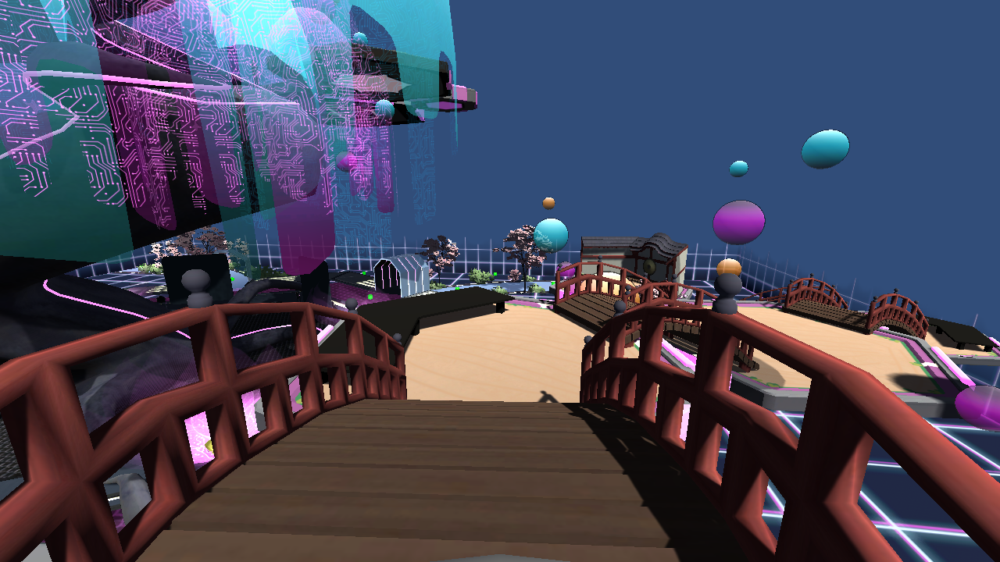
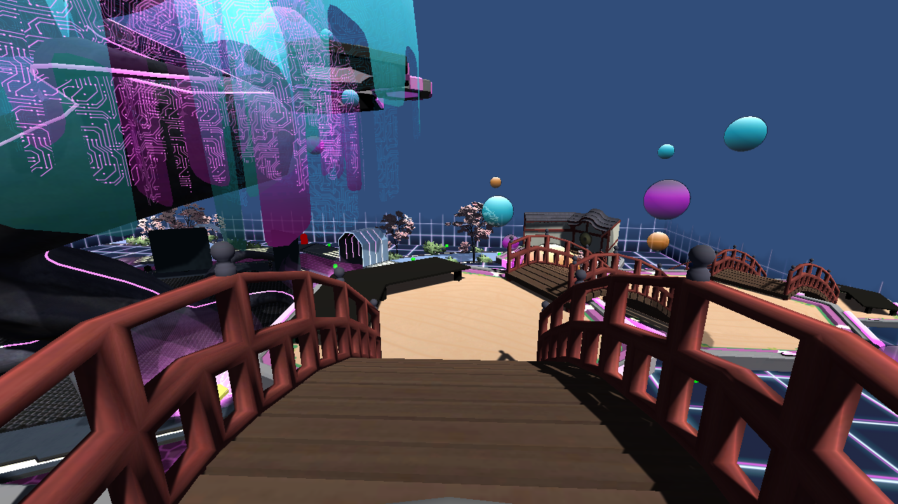

# I Am That Thing

**I Am That Thing** is a 3D possession-based stealth and escape game developed with Unity. Players take on the ability to possess various everyday objects within the environment, utilizing their unique physical properties and movement characteristics to sneak past patrolling AI enemies and escape undetected.

---

## Key Features & Mechanics

- **Object Possession System:** Seamlessly transfer consciousness into and out of interactive props scattered across the map.
- **Dynamic Prop Statistics:** Different objects offer tactical trade-offs:
  - *Small Objects:* High mobility and harder to spot, but fragile or limited in interaction.
  - *Large/Heavy Objects:* Slower movement speed, higher visibility risk, but useful for specific obstacles.
- **State-Driven AI Detection:** Enemies utilize a custom detection system with multiple behavioral states:
  - **Patrol:** AI follows designated waypoints while scanning the area.
  - **Suspicious:** Triggered when an object moves abnormally within the AI's peripheral vision or hearing range.
  - **Alert / Chase:** AI actively pursues the player upon confirming anomalous object movement.
- **Interactive Escape Level:** Navigate through environmental hazards and find the optimal route to the exit zone.

---

## Screenshots

| Gameplay Preview 1 | Gameplay Preview 2 |
| :---: | :---: |
|  |  |

---

## Controls

| Action | Key / Input |
| :--- | :--- |
| **Move** | `W`, `A`, `S`, `D` |
| **Camera Look** | `Mouse` |
| **Possess / Unpossess Object** | `E` / `Left Click` |
| **Jump / Special Action** | `Spacebar` |
| **Pause / Menu** | `ESC` |

---

## Project Structure

```text
i-am-that-thing-finalpj/
├── Assets/                  # Main Unity game assets, scenes, C# scripts, and prefabs
├── Packages/                # Unity Package Manager dependencies
├── ProjectSettings/         # Project configuration, tags, layers, and input settings
├── Screenshot_0.png         # Gameplay preview image 1
├── Screenshot_1.png         # Gameplay preview image 2
└── LICENSE                  # Project license information
```

---

## Tech Stack

- **Game Engine:** Unity
- **Programming Language:** C#
- **IDE:** Visual Studio Code / Visual Studio

---

## Getting Started (How to Open in Unity)

1. **Clone the repository:**
   ```bash
   git clone https://github.com/JULHMSPLOY/i-am-that-thing-finalpj.git
   ```
2. Open **Unity Hub** and click **Add** ➔ **Add project from disk**.
3. Select the cloned `i-am-that-thing-finalpj` directory.
4. Wait for Unity to import the packages and compile the C# scripts.
5. In the Project window, navigate to the `Assets/Scenes` folder and open the main scene to test in the Editor.

---

## License

[](https://creativecommons.org/licenses/by-nc/4.0/)

The custom source code and gameplay systems in this project are licensed under the **[Creative Commons Attribution-NonCommercial 4.0 International License (CC BY-NC 4.0)](https://creativecommons.org/licenses/by-nc/4.0/)** — see the [LICENSE](LICENSE) file for full details.

*Disclaimer: Third-party 3D environment models, props, and audio assets sourced from external creators remain the intellectual property of their respective owners and are used strictly for educational and non-commercial purposes.*
